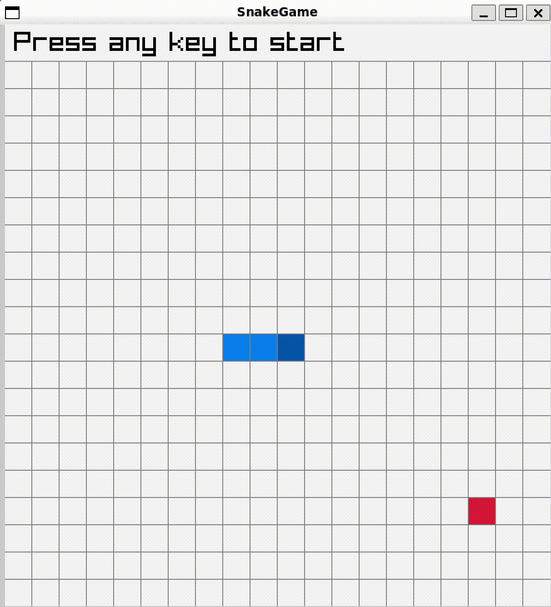

## SnakeGame

This is jsut a small project I did in raylib for fun. It's only on 
github so that I can work on it from another computer

## Build

make sure raylib is installed and then run 

```make```

and you could start it with 

```./snake.o```

## Demo 


